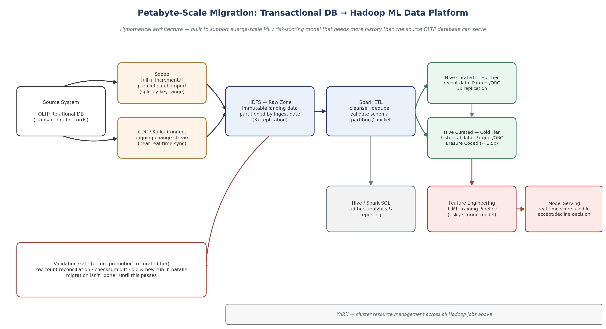

# SQL-to-Hadoop-Lake Migration Demo

A small, working, end-to-end simulation of migrating a relational (OLTP) database
into a Hadoop-style partitioned data lake — the same shape of migration used to
feed a large-scale ML/risk-scoring model with more historical data than a live
transactional database can serve.



This is a **toy-scale demo** (50,000 synthetic rows, local SQLite, local Parquet
files instead of a real HDFS cluster) built to prove the pipeline's *logic* end to
end: parallel bulk extraction, partitioned schema design, incremental sync, and —
the part that actually matters — a validation gate that blocks promotion until the
migrated data is proven correct.

The full architecture this scales up to (cluster sizing, the 3x-replication vs.
Erasure-Coding storage trade-off at real petabyte scale, the phased cutover plan)
is written up separately in **[docs/Hadoop_ML_Migration_Architecture_Proposal.docx](docs/Hadoop_ML_Migration_Architecture_Proposal.docx)** — this repo is the "does the
design actually work" companion to that proposal, not a replacement for it.

## What each piece maps to

| This repo | Real production equivalent |
|---|---|
| `source_db/generate_source.py` | The relational (OLTP) source database |
| `etl/migrate_to_lake.py` | Sqoop — parallel, key-range-split initial bulk load |
| `etl/incremental_sync.py` | CDC / Kafka Connect — ongoing change sync after the initial load |
| `lake/transactions/year=YYYY/month=MM/` | HDFS raw zone, partitioned by transaction date |
| `hive_ddl/create_external_table.hql` | The Hive external table this partition layout is designed for |
| `validation/reconcile.py` | The validation gate — row-count + checksum reconciliation before anything is trusted |

## Run it yourself

```bash
pip install -r requirements.txt

python source_db/generate_source.py      # build the synthetic 50k-row source DB
python etl/migrate_to_lake.py --workers 4   # Sqoop-style parallel initial load
python validation/reconcile.py           # validation gate -- should PASS

python source_db/simulate_new_rows.py    # simulate 500 new "live" transactions
python etl/incremental_sync.py           # CDC-style incremental sync
python validation/reconcile.py           # validation gate -- should PASS again

python etl/incremental_sync.py           # run again with nothing new -- safe no-op
```

Run the automated version of the same sequence with `pytest tests/ -v`.

## A real bug this caught

While building this, the first version of `incremental_sync.py` had no way of
knowing the initial full load had already covered rows 1–50,000 — it had its own
checkpoint that started at 0, so it quietly re-synced all 50,000 existing rows on
top of the 500 genuinely new ones. The validation gate (`reconcile.py`) caught it
immediately: the lake's row count and checksum stopped matching the source. The
fix was a shared `etl/checkpoint.py` that the initial load writes to when it
finishes, so the incremental sync always starts from where the last load — full
or incremental — actually left off.

This is left in the git history on purpose rather than cleaned up: it's a real,
small example of exactly the discipline the architecture proposal argues for —
don't trust that a migration worked, prove it with reconciliation.

## Design decisions worth being able to explain

- **Partitioned by transaction date, not ingestion date** — almost every query
  and every ML training run filters by a date range first, so this is the
  partition column that actually gets used.
- **Parquet, not CSV** — columnar storage means a query touching 3 of 7 columns
  only reads those 3 off disk, and compresses better since similar values sit
  together.
- **Threaded "mappers" split by primary-key range** — mirrors how Sqoop actually
  parallelizes a bulk import, just at thread-pool scale instead of cluster scale.
- **The reconciliation gate is a hard stop, not a warning** — `reconcile.py`
  exits non-zero on any mismatch specifically so it can be wired into CI or a
  migration runbook as an automated gate, not something a person has to remember
  to check.

## Limitations (said plainly, not hidden)

This is a demo of the pipeline's *logic*, not a benchmark of Hadoop at scale —
there is no real HDFS, YARN, or Hive metastore here, no real replication or
Erasure Coding, and 50,000 rows proves the approach works, not that it performs
at petabyte scale. The architecture proposal document is where the real
cluster-sizing math and storage trade-offs are worked through.
